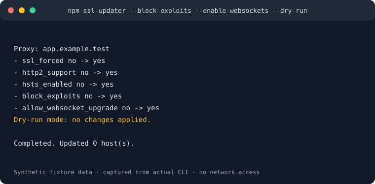

# Nginx Proxy Manager CLI

English | [Italiano](README.it.md)

Inspect and update Nginx Proxy Manager proxy hosts from the command line.

[](https://github.com/alsd4git/nginx-proxy-manager-ssl-cli/actions/workflows/tests.yml)
[](https://github.com/alsd4git/nginx-proxy-manager-ssl-cli/releases)
[](LICENSE)

The executable keeps its historical name, `npm-ssl-updater`.

## Install

Node.js 20 or newer is required. Install a tagged GitHub version:

```sh
npm install -g github:alsd4git/nginx-proxy-manager-ssl-cli#v1.0.0
npm-ssl-updater --help
```

## Preview before changing hosts

```sh
npm-ssl-updater --list-domains
npm-ssl-updater --block-exploits --enable-websockets --dry-run
```

Dry-run displays proposed changes without applying them. Use `--yes` only after
reviewing the preview. For password-safe automation, pass one newline-terminated
password through `--password-stdin` and include `--yes` or `--dry-run`.



The preview above is generated by the actual CLI using local synthetic fixtures.
See [how to regenerate it](docs/demo.md).

See the [English guide](README.en.md), [guida in italiano](README.it.md), and
[changelog](CHANGELOG.md) for configuration, certificates, access lists, and
advanced host operations.

## License

MIT. See [LICENSE](LICENSE).
